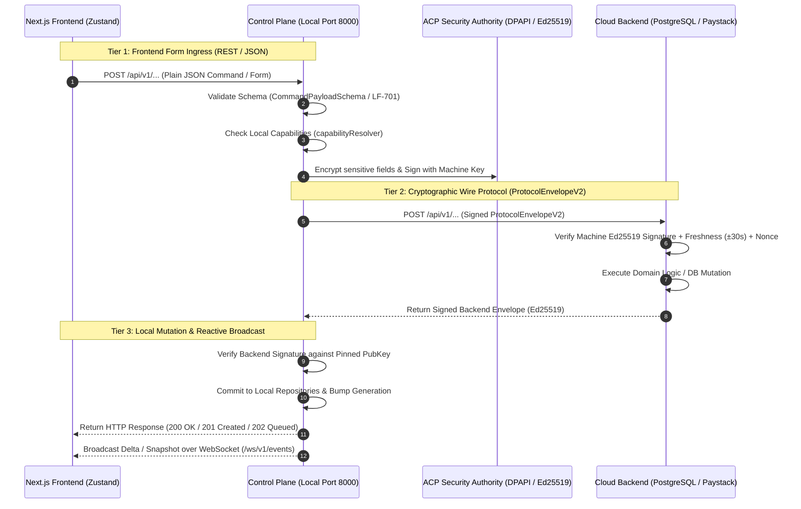

Based on an in-depth analysis of **`BACKEND_SPECIFICATION.md`**, the **`bettingAutomationControlPlane`** codebase, and the **`bettingAutomationBackend`** cloud backend, here is the complete specification of the **Request Formats, Data Contracts, and Mediation Pipeline**.

---

### 1. Communication Architecture & Data Mediation Flow

In this system, the **Next.js Frontend (Operations Console)** never talks directly to the **Cloud Backend (`bettingAutomationBackend`)**.

All data is routed through the **Control Plane (ACP)**, which acts as the local **Security Authority, Ingress Gateway, and State Reconciler**:



---

### 2. Tier 2 Wire Contract: Control Plane $\rightarrow$ Cloud Backend (`ProtocolEnvelopeV2`)

Every authenticated request sent from the Control Plane to `bettingAutomationBackend` must be encapsulated in a cryptographic envelope.

#### 2.1 The Wire Schema

```typescript
interface ProtocolEnvelopeV2 {
  version: 2; // Protocol version (must be 2)
  sessionId: string; // UUID of active session in backend
  machineId: string; // Machine UUID (registered in backend)
  nonce: string; // Single-use unique random string (60s TTL)
  timestamp: string; // ISO-8601 UTC string (server rejects drift > ±30,000ms)
  clientGeneration: number; // Monotonic counter (rejects counter decrease)
  clientServerEpoch: number; // Agreed epoch counter
  payload: any; // The business payload object or Base64 string
  signature: string; // Hex-encoded Ed25519 signature
}
```

#### 2.2 Canonical Serialization & Signature Rule

Before transmission, the Control Plane canonicalizes the envelope keys in alphabetical order (excluding the `signature` field itself):
$$\text{Signature} = \text{Ed25519\_Sign}(\text{DPAPI\_MachinePrivateKey}, \text{CanonicalJSON}(\{ \text{clientGeneration}, \dots, \text{version} \}))$$

The backend strictly verifies:

1. `timestamp` is within $\pm 30,000\text{ms}$ of backend wall clock (`NONCE_EXPIRED` if violated).
2. `nonce` has not been seen before in `server_nonces` table.
3. `machineId` exists in `machines` table and status is not `REVOKED`.
4. `signature` validates against the machine's registered `public_key_hex`.

---

### 3. End-to-End Form Request Formats (Frontend $\rightarrow$ ACP $\rightarrow$ Backend)

Below are the exact data structures for each major form across the application.

---

#### Form 1: Authentication & Machine Identity Handshake

Used during initial onboarding, first login, or machine re-registration.

##### A. Frontend Input to Control Plane

- **Method & URL**: `POST http://localhost:8000/api/v1/system/auth/login`

```json
{
  "email": "operator@bettingautomation.io",
  "password": "CorrectHorseBatteryStaple123!"
}
```

##### B. Control Plane Transformation & Call to Cloud Backend

The Control Plane retrieves the DPAPI-protected hardware identity descriptor, creates a client nonce, and dispatches to the backend:

- **Step 1: Auth Handshake** (`POST https://backend/api/v1/auth/init`):

```json
{
  "email": "operator@bettingautomation.io",
  "password": "CorrectHorseBatteryStaple123!",
  "machineId": "e3b0c442-98fc-1c14-9afbf4c8996fb924",
  "protocolVersion": 2,
  "clientNonce": "nonce_7f1c9842a1b94e32"
}
```

- **Step 2: Machine Public Key Registration** (`POST https://backend/api/v1/machines/register`):

```json
{
  "sessionId": "4bb28dfa-0db5-4bc6-8d59-2b0e685f4019",
  "installationId": "8f8b8091-2364-4e2a-bb39-65231c6a7981",
  "publicKeyHex": "6a2c74d812ef6587c6b907ad53ec2d126a2c74d812ef6587c6b907ad53ec2d12",
  "descriptor": {
    "os": "win32",
    "cpuModel": "AMD Ryzen 9",
    "macHash": "b73a45c..."
  },
  "selfSignature": "98a12e..."
}
```

##### C. Cloud Backend Response Envelope

```json
{
  "version": 2,
  "timestamp": "2026-09-07T20:15:00.000Z",
  "generation": 1,
  "payload": {
    "sessionId": "4bb28dfa-0db5-4bc6-8d59-2b0e685f4019",
    "accountId": "9d627694-537d-4221-bafa-cf1f163c6bdc",
    "sessionGeneration": 1,
    "nonceValidated": true
  },
  "signatures": {
    "1": "45f92b7810e9c1d..."
  }
}
```

---

#### Form 2: Bookmaker Account Registration Form

Used when adding a new bookmaker login (`SportyBet`, `Bet9ja`, etc.) in the Accounts modal.

##### A. Frontend Input to Control Plane

- **Method & URL**: `POST http://localhost:8000/api/v1/accounts`

```json
{
  "name": "Primary Sporty",
  "platformDisplayName": "SportyBet",
  "accountUsername": "sporty_trader_01",
  "accountPassword": "BookmakerSecurePassword99$",
  "tags": ["primary", "high-volume"]
}
```

##### B. Control Plane Ingress & Security Processing

1. **Schema Check**: Validates `platformDisplayName` is in `['SportyBet', 'Bet9ja', 'BetKing', '1xBet', 'Betway', 'Bet365', 'Pinnacle']`.
2. **Local Credential Storage**: Encrypts `accountPassword` using **Windows DPAPI / AEAD** in local SQLite (`bettingAutomationControlPlane`). The plaintext password is never sent to the cloud backend.
3. **Control Plane Response to UI**: Returns `201 Created` with masked password:

```json
{
  "id": "acc-1",
  "name": "Primary Sporty",
  "platformDisplayName": "SportyBet",
  "accountUsername": "sporty_trader_01",
  "backendState": "ACTIVE",
  "presentationCategory": "Neutral",
  "statusDescription": "Account registered and ready for activation",
  "isSelectable": true,
  "availableActions": ["ACTIVATE", "DELETE"],
  "tags": ["primary", "high-volume"],
  "lastUpdated": "2026-09-07T20:15:00.000Z",
  "lastSynchronization": "2026-09-07T20:15:00.000Z"
}
```

##### C. Control Plane $\rightarrow$ Cloud Backend Synchronization

The Control Plane replicates the non-secret metadata to the backend via state reconciliation:

- **Method & URL**: `POST https://backend/api/v1/reconciliation/sync`

```json
{
  "version": 2,
  "sessionId": "4bb28dfa-0db5-4bc6-8d59-2b0e685f4019",
  "machineId": "e3b0c442-98fc-1c14-9afbf4c8996fb924",
  "nonce": "n_98127391823791",
  "timestamp": "2026-09-07T20:15:01.000Z",
  "clientGeneration": 14,
  "clientServerEpoch": 1,
  "payload": {
    "action": "SYNC_ACCOUNTS_METADATA",
    "accountsSummary": [
      {
        "accountId": "acc-1",
        "platform": "SportyBet",
        "username": "sporty_trader_01",
        "status": "ACTIVE"
      }
    ],
    "localStateHash": "7f83b1657ff1fc53b92dc18148a1d65dfc2d4b1fa3d677284addd200126d9069"
  },
  "signature": "81f1c29e71ab82098d..."
}
```

---

#### Form 3: Settings Mutation Intent Form

Used when updating automation settings (Pricing, Risk, Proxies, Execution Timeouts).

##### A. Frontend Input to Control Plane (`IntentAck` pattern)

- **Method & URL**: `POST http://localhost:8000/api/v1/settings/intent`

```json
{
  "requestId": "req-98123-sett",
  "section": "strategy",
  "action": "UPDATE_PRICING",
  "target": "GLOBAL",
  "payload": {
    "mode": "PROFIT_TARGET",
    "baseStake": 500,
    "targetProfit": 150,
    "minimumAcceptableProfit": 20,
    "resolutionStrategy": "CLAMP_THEN_REDUCE_PROFIT",
    "platformIncrement": 1,
    "selectionPreference": "ROUND_NUMBERS",
    "restorePolicyOnRebet": true
  },
  "clientTimestamp": "2026-09-07T20:16:00.000Z",
  "expectedHash": "e3b0c44298fc1c149afbf4c8996fb92427ae41e4649b934ca495991b7852b855"
}
```

##### B. Control Plane Processing

1. Control Plane checks if capability `canEditPricing` is `true`.
2. Bumps configuration revision and stores updated configuration in local repository.
3. Returns `200 OK` response:

```json
{
  "requestId": "req-98123-sett",
  "status": "ACCEPTED",
  "section": "strategy",
  "data": {
    "appliedConfig": {
      /* updated pricing values */
    },
    "newRevision": 5
  },
  "message": "Strategy pricing updated successfully."
}
```

4. Emits `WORKSPACE_SNAPSHOT` over WebSocket with updated `globalConfig.pricing`.

---

#### Form 4: Billing Checkout & Paystack Flow

Used when subscribing or renewing the license (e.g. Pro Plan, ₦10,000/month).

##### A. Frontend Input to Control Plane

- **Method & URL**: `POST http://localhost:8000/api/v1/billing/checkout`

```json
{
  "planId": "PRO",
  "returnUrl": "http://localhost:3000/billing/callback"
}
```

##### B. Control Plane $\rightarrow$ Cloud Backend Payment Checkout

The Control Plane signs and dispatches the checkout intent:

- **Method & URL**: `POST https://backend/api/v1/payments/checkout`
- **Headers**: `Idempotency-Key: chk-9d627694-1725739200`

```json
{
  "accountId": "9d627694-537d-4221-bafa-cf1f163c6bdc",
  "planId": "PRO",
  "returnUrl": "http://localhost:3000/billing/callback"
}
```

##### C. Cloud Backend $\rightarrow$ Paystack Gateway

The backend calculates sub-units (Paystack requires amount in **Kobo**: `10000 * 100 = 1000000`) and calls Paystack API:

```json
{
  "email": "operator@bettingautomation.io",
  "amount": 1000000,
  "currency": "NGN",
  "callback_url": "https://backend/api/v1/payments/callback",
  "metadata": {
    "account_id": "9d627694-537d-4221-bafa-cf1f163c6bdc",
    "plan_id": "PRO"
  }
}
```

##### D. Response Flow

1. Backend returns `{ "checkoutUrl": "https://checkout.paystack.com/3910x..." }` to ACP.
2. ACP forwards `{ "checkoutUrl": "..." }` to Next.js Frontend.
3. Once paid, Paystack emits webhook `POST /api/v1/payments/webhook` with header `x-paystack-signature`.
4. Backend updates `subscriptions` table and writes a `CREATE_LICENSE` event to `outbox_events`.
5. Next sync or WebSocket push to the Control Plane issues the new license capabilities:
   - `planId`: `"Pro"`
   - `licenseStatus`: `"VALID"`
   - `limits.max_concurrent_browsers`: `5`

---

#### Form 5: Tactical Betting Operations (Control Plane Only)

Manual tactical betting actions (e.g., Tactical Bet or Cash Out) are executed **locally by the Control Plane's Automation Execution Engine (Playwright)**. They are not dispatched to the Cloud Backend, ensuring sub-millisecond execution without cloud latency.

##### A. Frontend Input to Control Plane

- **Method & URL**: `POST http://localhost:8000/api/v1/automation/operations/place-bet`

```json
{
  "marketId": "mkt-over-1.5-goals",
  "odds": 1.85,
  "stake": 2500
}
```

##### B. Control Plane Response

- Returns `202 Accepted` immediately:

```json
{
  "operationId": "op-01J79B5W8C9X32A",
  "status": "QUEUED"
}
```

- Control Plane updates `operationTracker.mjs`, dispatches command to Playwright worker over IPC pipe `\\.\pipe\control_plane_secure_ipc`, and broadcasts live execution state via WebSocket:

```json
{
  "type": "AUTOMATION_STATUS_TICK",
  "payload": {
    "globalActionPending": "PLACING_BET",
    "operationId": "op-01J79B5W8C9X32A"
  }
}
```

---

### 4. Summary Matrix: Routing & Payload Destinations

| User Form / UI Action         | Target Gateway                 | Wire Protocol                   | Target Backend Endpoint         | Notes                                                 |
| :---------------------------- | :----------------------------- | :------------------------------ | :------------------------------ | :---------------------------------------------------- |
| **Operator Login**            | ACP $\rightarrow$ Backend      | REST $\rightarrow$ `POST /init` | `/api/v1/auth/init`             | Bootstraps session & client nonce                     |
| **Machine Registration**      | ACP $\rightarrow$ Backend      | Signed JSON                     | `/api/v1/machines/register`     | Registers Ed25519 machine public key                  |
| **Add Bookmaker Account**     | ACP (Local)                    | REST JSON                       | Reconciled via `/sync`          | Plaintext passwords never leave CP (stored via DPAPI) |
| **Settings Intent Form**      | ACP (Local)                    | REST JSON (`IntentAck`)         | Reconciled via `/sync`          | Checked against `canEdit*` capabilities               |
| **Paystack Checkout**         | ACP $\rightarrow$ Backend      | REST (`Idempotency-Key`)        | `/api/v1/payments/checkout`     | Amount converted to Kobo (`1000000`)                  |
| **Paystack Webhook**          | Paystack $\rightarrow$ Backend | Signed REST                     | `/api/v1/payments/webhook`      | Verified via `x-paystack-signature`                   |
| **License / Capability Sync** | ACP $\rightarrow$ Backend      | `ProtocolEnvelopeV2`            | `/api/v1/authorization/resolve` | Resolves entitlements & grace tokens                  |
| **Tactical Bet / Cash Out**   | ACP (Local)                    | REST JSON                       | Executed via Playwright IPC     | 100% local; zero cloud latency                        |

This provides the exact payload structure for forms from both sides: how the Control Plane expects incoming data from the UI, and how it formats, signs, and reconciles that data with the cloud backend.
